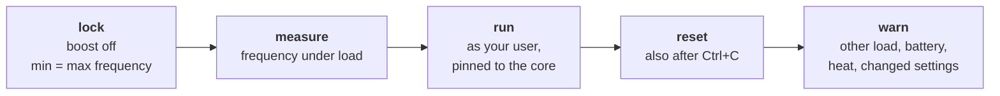

<div align="center">

# cputune

**Stable benchmarks on Linux.**<br>
Rank the CPU cores by speed, lock one at a fixed frequency, and run your benchmark on it.

[](https://github.com/martinus/cputune/actions/workflows/test.yml)
[](https://github.com/martinus/cputune/releases/latest)


[](LICENSE)


</div>

Boost, power-saving governors and heat change the CPU frequency while a benchmark runs, so the same
code gets different times. `cputune` turns boost off, fixes the frequency of one core, pins the
benchmark to it, and tells you when the result can still vary.

## Install

```sh
curl -fsSL https://github.com/martinus/cputune/releases/latest/download/cputune | python3 - install
```

> [!TIP]
> One Python file (3.9 or newer), no dependencies. It goes to `~/.local/bin`.
> Run `cputune install` again to update.

## Use

```sh
cputune                      # the cores (best first), the settings, what can make results vary
cputune -w                   # live view of the core frequencies (q: quit)
cputune run -- ./bench       # lock the best core, run ./bench on it, reset
```

| Command | What it does |
| --- | --- |
| `cputune run -c 2 -- ./bench` | The same as `run`, but always on CPU 2 (as `taskset -c 2`) |
| `cputune run --strict -- ./bench` | Run `./bench` only when the lock holds |
| `cputune lock` | Lock the best core (not CPU 0) at base frequency, boost off |
| `cputune lock 3GHz -c 2` | Lock CPU 2 and its SMT sibling at 3000 MHz |
| `cputune limit --max 2400` | All cores: at most 2400 MHz |
| `cputune reset` | Undo `lock` and `limit` (a reboot also does) |

`cputune --help` shows all commands, `cputune <command> --help` all options. Every command takes `--json`.

### How `run` works



> [!IMPORTANT]
> To compare runs, use the same CPU every time: `cputune run -c 2 -- ./bench`.
> The best-ranked core can change between runs.

> [!NOTE]
> Some CPUs run a little below the lock. A Ryzen 9 7950X locked at 4501 MHz runs at 4304 MHz.
> `cputune` measures the real frequency and shows it.

## Use without a password

`lock`, `run`, `limit` and `reset` need root, and run `sudo` themselves. Scripts and AI agents
cannot type a password. Run this once:

```sh
cputune install --no-password
```

> [!WARNING]
> This installs a root-owned copy in `/usr/local/bin` and adds a sudo rule for it. Under sudo,
> `cputune` only runs `lock`, `limit`, `reset` and `update`. Undo: `sudo rm /etc/sudoers.d/cputune`.

<details>
<summary><b>Instructions for AI agents</b> (copy into <code>AGENTS.md</code> or <code>CLAUDE.md</code>)</summary>

```markdown
For benchmarks, use `cputune run -- <command>`. It locks a fast core at a fixed
frequency, runs the command on it, and resets. To compare runs, always use the
same CPU: `cputune run -c 2 -- <command>`. stdout and the exit code are the
ones of the command. When cputune prints a warning, the result may vary: tell
the user. With `--json`, cputune writes JSON to stderr, with `"stable": false`
and the `warnings`. If `cputune` says that sudo needs a password, stop and ask
the user to run `cputune install --no-password`.
```

</details>

<details>
<summary><b>Tested machines</b></summary>

The tests use recorded sysfs data from these machines, see [tests/machines](tests/machines).

| CPU | Frequency driver |
| --- | --- |
| AMD Ryzen 9 7950X, Ryzen 5 5500GT, Ryzen AI 7 350 | `amd-pstate-epp` |
| AMD EPYC 9354P | `acpi-cpufreq` |
| Intel Core i9-13950HX (P- and E-cores) | `intel_pstate` |
| Raspberry Pi 4 | `cpufreq-dt` |

</details>

<details>
<summary><b>Development</b></summary>

```sh
python3 tests/run.py                  # all tests, in parallel (a few seconds)
python3 tests/hardware_check.py       # lock, limit, reset and run on this machine (uses sudo)
```

Increase `__version__` for every change to `cputune`. After a merge to `main`, CI creates the tag
and the [GitHub release](https://github.com/martinus/cputune/releases).

</details>

## License

[0BSD](LICENSE)
