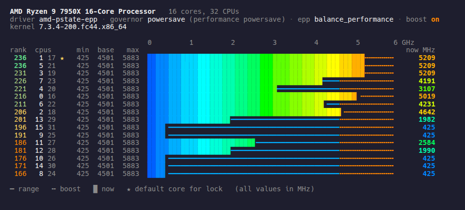

# cputune

`cputune` shows the CPU cores of a Linux machine ranked by speed, and locks
their frequency, so that benchmarks give stable results. It is one Python file
(3.9 or newer) with no dependencies.



## Install

```sh
curl -fsSL https://raw.githubusercontent.com/martinus/cputune/main/cputune | python3 - install
```

This installs `cputune` in `~/.local/bin`. `cputune update` installs a newer
version from GitHub.

## Use

```sh
cputune                       # show the cores, best rank first
cputune watch                 # live view of the core frequencies
cputune run -- ./bench        # lock the best core, run ./bench on it, then reset
cputune run -c 2 -- ./bench   # the same on CPU 2, as taskset -c 2: same CPU every time
cputune lock                  # lock the best core (without CPU 0) at base frequency
cputune lock 3GHz -c 2        # lock CPU 2 and its SMT sibling at 3000 MHz
cputune limit --max 2400      # all cores: at most 2400 MHz
cputune reset                 # undo lock and limit
```

`lock` turns boost off, sets the `performance` governor, and sets the minimum
and maximum frequency to the same value. Then it measures the frequency under
load. `reset` restores the settings from before. A reboot also restores them.

`run` is the easiest way to get stable results: it locks, runs the command as
your user, and always resets, also after Ctrl+C. Without `-c`, it picks the
best-ranked core. With `-c`, the command runs on exactly these CPUs, so results
stay comparable between runs. `lock` and `run` always lock the whole core: SMT
siblings share one frequency.

`cputune --help` and `cputune <command> --help` show all options. All commands
accept `--json`.

## Use without a password prompt

`lock`, `run`, `limit` and `reset` need root, and they run `sudo` themselves.
Scripts and AI agents have no terminal to type a password. To allow `cputune`
without a password, run this once:

```sh
cputune sudoers --install
```

It installs `cputune` in `/usr/local/bin`, owned by root, and adds a sudo rule
for that copy. Root always runs this copy, also when you start another one, for
example in `~/.local/bin`. `cputune update` updates both. `cputune sudoers`
shows the status. Under sudo, `cputune` only runs `lock`, `limit`, `reset` and
`update`, so the rule gives no more than the CPU settings. Undo:
`sudo rm /etc/sudoers.d/cputune`.

## Use from AI agents

Copy this into the instructions of your agent, for example `AGENTS.md` or `CLAUDE.md`:

```markdown
For benchmarks, use `cputune run -- <command>`. It locks a fast core at a fixed
frequency, runs the command on it, and resets. To compare runs, always use the
same CPU: `cputune run -c 2 -- <command>`. stdout and the exit code are the
ones of the command. `cputune show --json` shows the state of the machine. If
`cputune` says that sudo needs a password, stop and ask the user to run
`cputune sudoers --install`.
```

## Development

```sh
python3 -m unittest discover -s tests
```

The tests run against fake sysfs trees, built from the recorded machines in
[tests/machines](tests/machines). Increase `__version__` for every change to
`cputune`. After a merge to `main`, CI creates the tag and the
[GitHub release](https://github.com/martinus/cputune/releases).

## License

[0BSD](LICENSE)
